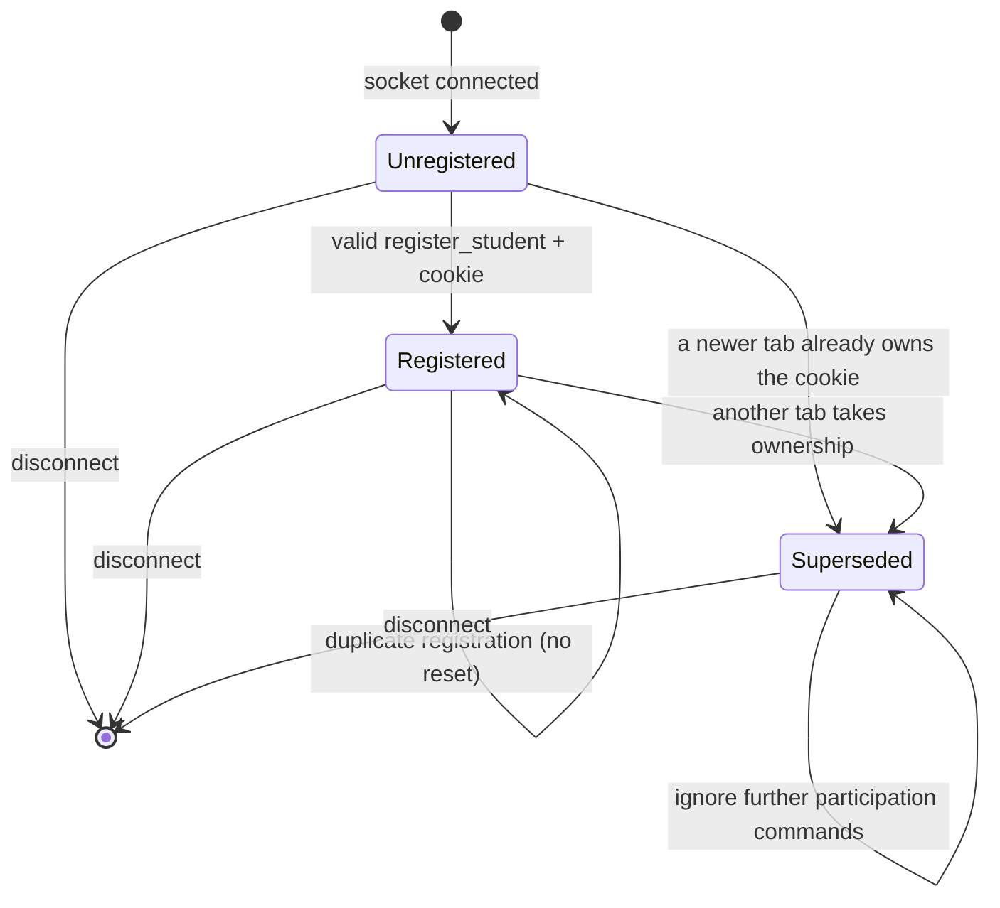
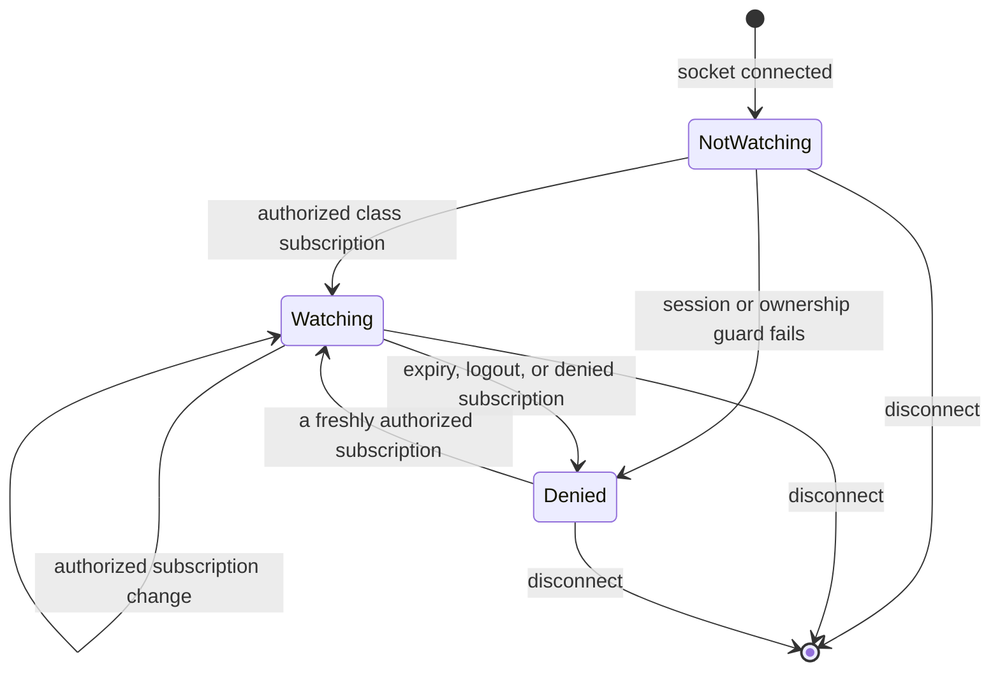

# State machines and transition contracts

This is the map of the application's stateful behavior. Start here before changing an event, authentication flow, or browser interaction. The application uses Rust enums and small JavaScript reducers; no state-machine framework or frontend build step is required.

## Ownership and inventory

| Flow | States / outcomes | Owner and transition entry point |
| --- | --- | --- |
| Application lifecycle | starting → ready → draining → stopped; failures exit | `src/main.rs`, `run` / `shutdown`; named lifecycle log fields |
| Schema initialization | missing → created; existing → reused; failure → startup fails | `src/db.rs`, `open`; SQLx / SQLite own connection and transaction internals |
| Account registration | unvalidated → rejected or validated → transaction → committed / rolled back → redirect | `src/forms.rs`, `validate_signup`; `src/http.rs`, `signup` |
| Session issuance | prepared → persisted → committed → cookie issued | `src/auth.rs`, `NewSession`; the account and its initial session commit together |
| Session authentication | anonymous: missing / invalid / expired; authenticated | `src/auth.rs`, `SessionState::resolve` / `session_state`; logout deletes the persistent token |
| Class creation | input → invalid / validated name → taken / created | `src/forms.rs`, `ClassName::parse`; `src/http.rs`, `create_class`; SQLite enforces global uniqueness |
| Class access | sign-in required / forbidden / allowed | `src/auth.rs`, `ClassAccess` / `class_access`; shared by HTTP and sockets |
| Socket transport | connecting / connected / disconnected; polling / upgrade / WebSocket; heartbeat / timeout / retry | Socketioxide and the Socket.IO client own the protocol; `src/realtime.rs`, `attach`, guards its application boundary |
| Server student participation | unregistered → registered ↔ feedback states; registered → superseded; disconnect removes connection | `src/classroom.rs`, `StudentState`, `Event`, `Classroom::transition` |
| Student feedback | inactive / green / yellow / red; changes allowed only while registered | `src/classroom.rs`, `Feedback`, `ChangeFeedback` |
| Tab ownership | no owner → newest registration; older / replaced tab → superseded | `src/classroom.rs`, `register`; one registration per student cookie across all classes |
| Teacher subscription | not watching → watching / denied; watching → watching another class / denied; disconnect removes connection | `src/classroom.rs`, `TeacherState`; `Watch`, `Deny`, `RevokeSession`, `Tick` |
| Browser student | connecting → registering → ready ↔ sending; offline → registering; superseded / error require reload | `static/state-machines.mjs`, `studentTransition`; `static/app.mjs`, `initStudent` |
| Browser teacher | connecting → joining → live; offline → joining; denied / error require sign-in, dashboard, or reload | `static/state-machines.mjs`, `teacherTransition`; `static/app.mjs`, `initTeacher` |
| Browser POST forms | ready / rejected → submitting → native navigation; browser history restore → ready / rejected | `formTransition`, `initForms`; HTML validation runs before submit; no fetch replacement |
| Theme preference | system / explicit light / explicit dark; system and cross-tab storage events | `themeTransition`, `resolvedTheme`, `initTheme`; the early layout script applies the initial preference before paint |
| QR sharing | closed → loading → ready / error; any open state → closed; another class → loading | `qrTransition`, `initQrModal`; request generations reject old image callbacks |
| External resource availability | Socket.IO script unavailable → recoverable connection error; QR image load → ready / fallback link | `initStudent`, `initTeacher`, `initQrModal`; browser owns HTTP/cache/image delivery |

Counts, fractions, rendered meter heights, validation guards, safe return URLs, and light/dark CSS are **derived values**, not separate mutable state machines. They are computed from the authoritative states above. SQLite, HTTP, and Socket.IO internals remain owned by their libraries rather than being duplicated in application code.

## Classroom model

`Classroom` has no network, database, clock reads, or spawned tasks. Its only mutation entry point is:

```rust
Classroom::transition(event, now) -> Transition { outcome, effects }
```

The caller supplies time. `Outcome` uses typed success states and rejection reasons. `Effect` describes stats delivery, tab deactivation, or subscription termination. `src/realtime.rs` performs authorization, calls the model under a short mutex, executes the effects, and sends an optional acknowledgement. HTTP snapshots call the model's derived `stats` method.

Each connection has **independent** student and teacher states: a teacher may also have a student cookie. Conflating the two roles would break that existing behavior.





The browser deliberately treats access denial as terminal for the current page, with a visible recovery action. The server can accept a later subscription only after fresh authorization. A disconnected connection cannot be resurrected by a late authorization result.

### Invariants and ordering

1. Only registered, connected students contribute to counts. Exactly one registration may own a student cookie, even across classes and equal-timestamp tabs.
2. Registration retries for the same socket, timestamp, and class preserve feedback and emit no duplicate stats. Actual class changes reset feedback to inactive and notify both classes.
3. Supersession is terminal for that socket. The old tab cannot steal ownership after the new tab disconnects. A reload creates a new socket and page timestamp.
4. Older registration replays cannot erase the current socket's feedback. Invalid timestamps, missing cookies, and unknown sockets cannot create participation.
5. Disconnect is idempotent. Disconnecting an old tab cannot remove the replacement's registration.
6. Fractions use active students only. With no active students all fractions are zero. Counts and fractions are calculated from participation, never maintained as independent counters.
7. A teacher needs a valid session and class ownership for every subscription. A denied subscription removes any previous watch on that connection.
8. Expiry is checked **before every event's effects**, and a weakly owned one-second clock checks quiet classrooms too. Expired subscriptions receive no further stats and are notified once.
9. Authorization + subscribe and logout + revoke serialize through `auth_gate`. Database work holds this gate, not the classroom mutex. Both paths acquire the gate before the classroom mutex; there is no reverse acquisition. This prevents an authorization started before logout from installing a subscription afterward.
10. Transport adapters check the socket's actual connected status before attaching it. The pure model also rejects watch / register events for absent connections.
11. Account creation and initial session persistence share one SQLite transaction. A session failure rolls back the account, so retry does not encounter a partially created account. Cookies are issued after commit.

## Browser contract

Reducers return a new state or the same state for an ignored event. They contain no DOM, storage, sockets, or timers. Controllers perform effects and render a `data-state` attribute plus accessible status text. Student choices are actual buttons with disabled and pressed states.

- A student can select only while registered and connected. The cup changes only after the server confirms the color. Offline clicks are disabled and never added to Socket.IO's reconnect buffer.
- Connection epochs and submission revisions invalidate acknowledgements from a previous connection or command. A late success or failure cannot undo offline or superseded state.
- Reconnection registers again and resets the student to inactive, matching the server. A failed acknowledgement presents a reload action rather than pretending feedback was delivered.
- A teacher's counts become live only after valid stats for that class arrive. Disconnection retains the last snapshot, dims it, and explicitly labels it stale. Expiry and revocation offer sign-in recovery.
- Native form navigation remains intact, including operation without JavaScript. During submission only submit buttons are disabled; inputs still serialize normally. Browser back/forward cache restoration re-enables submission. Validation responses retain email / class input, never passwords.
- Theme changes still work when local storage throws. A system preference follows OS changes; an explicit preference wins. Storage events synchronize other tabs. Theme boot is deliberately small and synchronous to avoid a flash before module loading.
- A QR request has a generation. Late load/error events from another generation cannot affect a reopened modal. Failures retain the usable student link. The modal contains keyboard focus, makes the background inert, closes on Escape/backdrop, and returns focus to its opener.

## Socket.IO compatibility

Existing event names, arguments, stats shape, database schema, password hashes, cookie names, and HTTP routes are unchanged. Legacy clients can continue sending commands without acknowledgements.

New clients may include a normal Socket.IO acknowledgement callback on `register_student`, `color_change`, and `join_teacher_class`:

```json
{"status":"ok","state":"registered"}
{"status":"ok","state":"updated"}
{"status":"ok","state":"watching"}
{"status":"error","reason":"not_registered"}
```

Rejection reasons are `disconnected`, `student_cookie_required`, `invalid_registration`, `superseded`, `not_registered`, `unauthenticated`, `expired`, `revoked`, `forbidden`, and `unavailable`. Malformed payloads continue to be ignored by the typed Socket.IO extractor. A callback timeout is a client error, not confirmation of an update.

`deactivate_old_tabs` retains `student_id` and `timestamp` and adds `superseded: true`. This lets new clients retire equal-timestamp tabs too. `teacher_access_ended` is an additive event with `{reason: "expired"}` or `{reason: "revoked"}`. Old clients ignore it and still stop receiving data. Successful teacher subscription sends initial stats before its acknowledgement; clients must handle that order.

Live participation and socket subscriptions reset on process restart. Accounts, sessions, and classes persist. This remains a single-process application; shared multi-instance state is outside this change.

## Verification and change recipes

Run all checks with a Rust toolchain and Node installed:

```bash
bash scripts/check.sh
```

`src/classroom/tests.rs` tests deterministic event sequences and invariants, including exact expiry boundaries, duplicate registration, equal timestamps, terminal supersession, late authorization, class switches, and stale disconnects. `src/auth.rs` tests session classification with fixed time and offsets. `tests/http.rs` checks persistence, legacy compatibility, preserved form inputs, rollback, and concurrent signup. `tests/realtime.rs` exercises real polling/WebSocket framing, optional acknowledgements, access guards, revocation, and quiet-session expiry. `tests/browser/*.test.mjs` tests reducer races, recovery, and the production DOM/socket controllers with a lightweight harness and no npm dependencies. The harness verifies wiring and rendered state, not browser layout.

To add a classroom event: extend `Event`, define its guards and legal state transitions, return typed effects, add a deterministic model test, then wire the transport and its protocol test. To add a browser interaction: extend its reducer first, test stale/duplicate/terminal events, then render and execute effects in the controller. Change this document when changing a transition or protocol contract.

For local diagnostics, use `RUST_LOG=cups=trace`. The adapter logs outcome states and rejection reasons; session tokens and passwords are not included. Browser `data-state` attributes provide stable selectors for inspection and UI tests.
